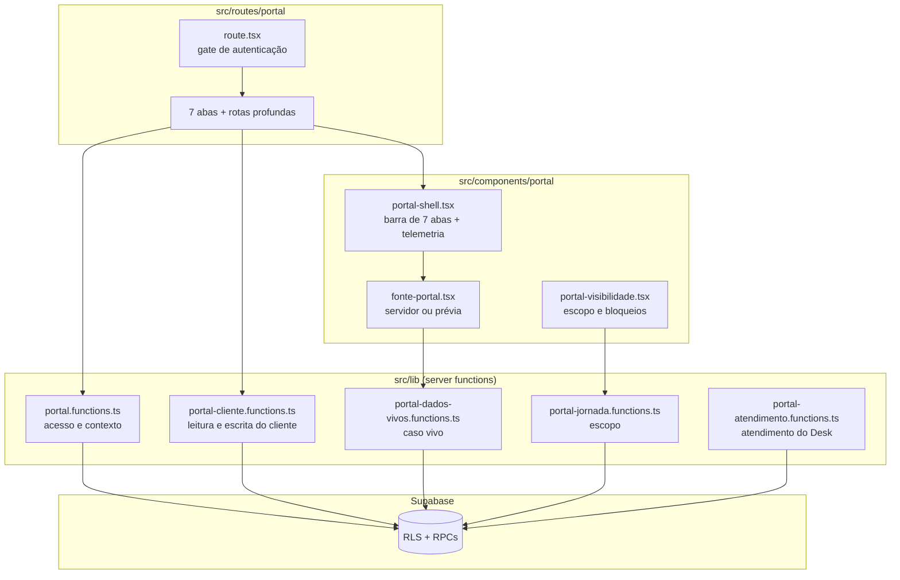
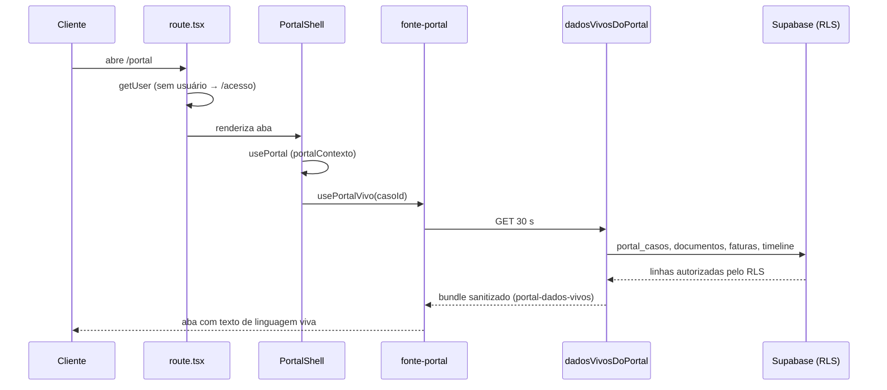

# Mapa do App Cliente

> Gerado pelo Cartographer, restrito ao App Cliente por decisão da Proprietária (12/10/2026). Não cobre o Desk, o restante de `src/lib` nem `atendimento-interno.tsx` (uso interno).
> Leitura somente. As observações da seção final são **hipóteses para revisão**, não defeitos confirmados.

## Visão geral

O App Cliente é uma área autenticada com sete abas canônicas: Home, Jornada, Radar, Árvore, Documentos, Legado e Conta. As demais rotas (entregas, fases, casos, mensagens, faturas, proposta) existem, mas não aparecem na barra de navegação.

## Estrutura de diretórios

| Caminho | Conteúdo |
|---|---|
| `src/routes/portal/` | 15 rotas: layout, sete abas, entregas, fases, caso, mensagem, faturas, proposta |
| `src/components/portal/` | Shell, fonte de dados, visibilidade, blocos de conteúdo e exemplos visuais |
| `src/lib/portal*.ts` | Server functions, helpers de servidor, sanitizadores puros, copy e navegação |
| `src/lib/__tests__/portal-*.test.ts` | 9 arquivos de teste (não detalhados aqui) |

## Rotas

| URL | Arquivo | Componente |
|---|---|---|
| `/portal` | `routes/portal/index.tsx:38` | `PortalHome` |
| `/portal/jornada` | `jornada.tsx:278` | `PortalJornada` |
| `/portal/radar` | `radar.tsx:13` | `PortalRadar` |
| `/portal/arvore` | `arvore.tsx:26` | `PortalArvore` |
| `/portal/documentos` | `documentos.tsx:18` | `PortalDocumentos` |
| `/portal/legado` | `legado.tsx:19` | `PortalLegado` |
| `/portal/conta` | `conta.tsx:14` | `PortalConta` |
| `/portal/entregas` | `entregas.tsx:20` | `PortalEntregas` |
| `/portal/fase-01` | `fase-01.tsx:20` | `PortalFase01` |
| `/portal/fase-02` | `fase-02.tsx:19` | `PortalFase02` |
| `/portal/casos/$id` | `casos.$id.tsx:7` | `CasoPage` → `PortalCasoDetalhe` |
| `/portal/mensagens/$id` | `mensagens.$id.tsx:10` | `MensagemPage` |
| `/portal/faturas` | `faturas.tsx:9` | `FaturasPage` |
| `/portal/proposta` | `proposta.tsx:10` | `PropostaPage` |

Todas as rotas usam `robots: noindex`. O layout `route.tsx:13` define `ssr: false`, aceita apenas `?casoId=` na busca e redireciona para `/acesso` sem usuário (`:34`). Autenticar não é autorizar: a autorização real está no RLS e na checagem `data.autorizado` do `PortalShell`.

## Navegação: as sete abas

- `components/portal/portal-shell.tsx:127-137` monta a barra com Home, Jornada, Radar, Árvore, Documentos, Legado e Conta. Os rótulos vêm de `COPY_TELAS`.
- A barra só aparece com `acessoCompleto` (`previa || nivel === "client_workspace"`, `:119`). Acesso só de proposta não vê barra.
- Entregas, Fase 01 e Fase 02 saem da barra (comentário em `:115-118`). São alcançadas por links internos: `jornada.tsx:554/560/569`.
- `casos/$id` é linkado de `index.tsx:415`; `mensagens/$id` de `caso-detalhe.tsx:316`.
- **Faturas e proposta não têm link encontrado nos arquivos mapeados** (acesso direto por URL, ou link em outro lugar não verificado).
- O cabeçalho tem um link "Conta" extra (`portal-shell.tsx:152`), que duplica a aba.
- A telemetria de permanência cobre só Home, Radar, Árvore e Legado (`portal-shell.tsx:33-38`).
- Há uma segunda lista das abas em `abas-app-cliente.tsx:14` (`ABAS_APP_CLIENTE`), e `portal-mapa-kit.ts` faz o mesmo mapeamento. Duas listas podem divergir.

## Fluxo de dados

Cada aba escolhe a fonte pelo `FontePortalProvider`:
- **Servidor:** `usePortalVivo` (`fonte-portal.tsx:126`) chama `dadosVivosDoPortal` a cada 30 s (`:143`).
- **Prévia:** com provider, a consulta do servidor fica desligada e os dados vêm do fixture de demonstração (`usePreviaPortal`, `:170`).

## Módulos

### Servidor

| Módulo | Papel | Tabelas e RPCs principais |
|---|---|---|
| `portal.functions.ts` | Link mágico, confirmação, contexto, proposta e console de acessos (1048 linhas) | `client_portal_access`, `authorized_portal_emails`, `portal_casos`, `invoices` (via RPC) |
| `portal-cliente.functions.ts` | Leitura e escrita do cliente: casos, uploads, entregas, tickets, faturas, compartilhamentos (725 linhas) | `portal_document_requests`, `portal_tickets`, `invoices`, `documents`, RPCs `portal_sou_contratante_financeiro` e `portal_membros_do_meu_caso` |
| `portal-dados-vivos.functions.ts` | Leitura viva de um caso para as abas | `portal_casos`, `portal_projecoes`, `documents`, `invoices`, `case_timeline_events` |
| `portal-atendimento.functions.ts` | Atendimento do Desk: solicitações, revisão, liberação, tickets, publicação no app (973 linhas) | `crm_casos`, `documents`, `invoices`, `app_projections`, `audit_logs` |
| `portal-jornada.functions.ts` | Escopo do que o cliente pode ver | `client_portal_access`, `documents`, `portal_casos` |
| `portal.server.ts` | Helpers de gestão de acesso e link mágico, com service role | `client_access_events`, `audit_logs`, `organization_members`, `user_roles` |
| `portal-cliente.server.ts` | Helpers de acesso e upload do cliente | `client_portal_access`, `case_alerts` |

**Funções públicas:** `solicitarLinkAcesso` (`portal.functions.ts:15`) não usa middleware. Limita a taxa e sempre responde `{ok:true}`. Todas as demais usam `requireSupabaseAuth`.

**Server functions por módulo**

- `portal.functions.ts`: `solicitarLinkAcesso` (:15), `confirmarAcessoPortal` (:89), `portalContexto` (:187), `portalCaso` (:227), `portalDocumentos` (:274), `portalProposta` (:290), `listarAcessosPortal` (:334), `registrarEmailAutorizado` (:399), `validarEmailAutorizado` (:455), `listarEventosAcesso` (:505), `criarConvitePortal` (:520), `reenviarConvitePortal` (:678), `alterarStatusAcessoPortal` (:763), `definirCasoDoAcesso` (:889), `definirLiberacaoCaso` (:994).
- `portal-cliente.functions.ts`: `meusCasos` (:19), `meuCaso` (:87), `prepararEnvioDocumento` (:222), `confirmarEnvioDocumento` (:244), `baixarEntrega` (:314), `abrirTicket` (:360), `meuTicket` (:410), `responderTicketCliente` (:442), `minhasEntregas` (:480), `minhasFaturas` (:529), `autorizarCompartilhamentoAchado` (:588), `revogarCompartilhamentoAchadoPortal` (:618), `membrosDoMeuCaso` (:656), `meusCompartilhamentosDeAchado` (:674), `registrarTempoNaAba` (:704).
- `portal-atendimento.functions.ts`: `painelAtendimento` (:60), `criarSolicitacaoDocumento` (:195), `cancelarSolicitacaoDocumento` (:311), `revisarEnvioCliente` (:349), `liberarEntregaCliente` (:429), `liberarFaturaCliente` (:549), `confirmarDocumentosMinimos` (:658), `publicarProjecaoApp` (:722), `despublicarProjecaoApp` (:792), `ticketInterno` (:831), `responderTicketEquipe` (:859), `atualizarStatusTicket` (:941).
- `portal-dados-vivos.functions.ts`: `dadosVivosDoPortal` (:44).
- `portal-jornada.functions.ts`: `escopoDoPortal` (:17).

**Puros (sem I/O):** `portal-dados-vivos.ts` (sanitizadores, 490 linhas), `portal-linguagem-viva.ts` (remove marcas técnicas do texto), `portal-copy.ts` (copy canônica e termos proibidos), `portal-navegacao.ts`, `portal-mapa-kit.ts`, `portal-elegibilidade.ts` (regras espelhadas dos triggers, consultivas), `portal-envio-arquivo.ts` (extensões e 25 MB), `portal-entregas.ts`, `portal-arvore-geracoes.ts`.

**Dependências entre módulos do portal**

- `portal-cliente.functions` → `portal-cliente.server`, `portal.server`, `portal-entregas` (dinâmicos).
- `portal-dados-vivos.functions` → `portal-dados-vivos` → `portal-linguagem-viva` → `portal-copy`.
- `portal.functions` → `portal.server`, `portal-cliente.server`, `portal-elegibilidade` (dinâmicos).
- `portal-demo-sophia` → só o tipo `DadosPortal` de `fonte-portal`.

### Componentes

| Componente | Papel |
|---|---|
| `portal-shell.tsx` | Layout, barra de sete abas, telemetria. Pula o redirecionamento de não autorizado na prévia (`:105-112`) |
| `fonte-portal.tsx` | Costura de fonte: servidor ou provider de prévia. `LinkPortal` vira botão na prévia |
| `portal-visibilidade.tsx` | Estados de visibilidade por tela. `ESCOPO_INDEFINIDO` bloqueia enquanto carrega; `ESCOPO_PREVIA` libera a prévia |
| `abas-app-cliente.tsx` | Lista das abas e mapa de telas internas (`rotaInternaDoPortal` cai em `/portal`) |
| `sessao-demo-app-cliente.tsx` | Sessão de demonstração para o Desk (`modo` desk ou cliente) |
| `andamento-publicado.tsx` | Faixa de progresso. Oculta no Radar |
| `radar-seis-eixos.tsx`, `explorador-arvore.tsx`, `origem-geografica.tsx`, `secao-documental.tsx` | Visualizações. `origem-geografica` é sempre placeholder |
| `caso-detalhe.tsx`, `compartilhar-achado-cliente.tsx`, `enviar-documento.tsx` | Ações do cliente sobre o caso |
| `bloco-exemplo-visual.tsx`, `exemplos-visuais-mockup.ts` | Blocos ilustrativos com copy fixa e botões desabilitados. Usados como estado vazio |
| `portal-v11.css` | Estilos com escopo `[data-app-cliente]`, para não afetar o Desk. Só o cabeçalho foi lido |

## Dados de demonstração e fixtures

- `lib/portal-demo-sophia.ts` é um caso fictício (Sophia Piccoli) com projeções e documentos fixos. É importado por `portal-shell.tsx`, `sessao-demo-app-cliente.tsx` e pelas rotas `index`, `jornada`, `conta`, `entregas`, `fase-01` e `fase-02`. Cada uso depende de `fonte === "demo"` ou de `CASO_DEMO_CODIGO`; não foi verificado se todos os caminhos são protegidos.
- `exemplos-visuais-mockup.ts` é copy fixa, marcada como "Exemplo do layout — ainda sem dados publicados".
- Filtros de fixture aplicados via `semFixtures`/`ehFixtureLinha`: `meusCasos`, `meuCaso`, `minhasEntregas`, `minhasFaturas`, `portalDocumentos`, `escopoDoPortal`. `documentos.tsx:51` filtra `is_demo`. `radarSanitizado` descarta documentos `is_demo`.

## Convenções

- Server functions com `createServerFn` e `requireSupabaseAuth`. Leituras de cliente via RLS, com `client_id` ou `case_id` explícitos em vários pontos.
- Sanitização antes da tela: `portal-dados-vivos.ts` e `portal-linguagem-viva.ts` removem marcas técnicas e termos proibidos (`TERMOS_PROIBIDOS_CLIENTE`, `portal-copy.ts:163`).
- Escrita de service role concentrada em `portal.server.ts` e em trechos de `portal-cliente.functions.ts` (URLs assinadas, `audit_logs`).
- Erros de leitura de caso, negação e "não liberado" retornam a mesma mensagem neutra (`mensagemIndisponivel`).

## Armadilhas

- `portal-shell.tsx` e `abas-app-cliente.tsx` mantêm listas de abas separadas. Mudar uma sem a outra deixa a navegação inconsistente.
- A telemetria cobre só quatro abas. Jornada, Documentos e Conta não são medidas.
- `portal-demo-sophia.ts` é fixture dentro de código de produção. Não remover sem checar os importadores.
- `PortalShell` pula o redirecionamento de não autorizado na prévia. Isso é intencional, mas afeta quem testa pelo Desk.
- `portal-elegibilidade.ts` é consultivo; quem decide é o servidor e o banco.
- `garantirUsuarioAuth` (`portal.server.ts:111`) busca só 200 usuários, sem paginação.

## Observações para revisão

Estes pontos saíram da leitura automatizada. Os três primeiros foram conferidos no código; os demais precisam de confirmação.

1. **[Conferido] `listarEventosAcesso`** (`portal.functions.ts:505-516`) filtra só por `client_portal_access_id`, sem checagem de organização ou papel. Depende inteiramente do RLS de `client_access_events`.
2. **[Conferido] Faturas em `dadosVivosDoPortal`** (`portal-dados-vivos.functions.ts:148`) filtram por `case_id` e status, sem `client_id`. O resultado vira só um booleano (`pagamentoPendente`), mas uma fatura aberta de outro contratante no mesmo caso influencia o resultado.
3. **[Conferido] `meuCaso`** (`portal-cliente.functions.ts:126-131`) filtra faturas por `client_id`, mas não aplica o RPC `portal_sou_contratante_financeiro`, que `minhasFaturas` e `portalProposta` usam. A regra do AGENTS.md pede estado neutro para não contratante quando `restritoAoContratante`. Vale verificar se `meuCaso` deve seguir a mesma regra.
4. **[A confirmar] Funções sem checagem de papel**: `ticketInterno`, `responderTicketEquipe`, `atualizarStatusTicket`, `criarSolicitacaoDocumento` e `cancelarSolicitacaoDocumento` (`portal-atendimento.functions.ts`) exigem só pertencimento à organização. `ticketInterno` (`:831`) usa `contextoDocumentos` e não verifica papel.
5. **[A confirmar] Leituras só com RLS**: `meuTicket`, `baixarEntrega`, `minhasEntregas`, `portalDocumentos`, `revogarCompartilhamentoAchadoPortal` e `autorizarCompartilhamentoAchado` (que confia em `compartilharComClienteId` do payload) dependem apenas de RLS.
6. **[A confirmar] `documents` em `dadosVivosDoPortal`** (`:139`) não passa por `semFixtures`.
7. **[A confirmar] Acesso de service role em `listarAcessosPortal`**: qualquer usuário autenticado chega à leitura administrativa de `app_projections`, filtrada por organização.

## Não coberto neste mapa

- `components/portal/atendimento-interno.tsx` (1168 linhas) é o atendimento interno do Desk, usado por `routes/_authenticated/atendimento.tsx`, não pelo `/portal`.
- O CSS `portal-v11.css` (943 linhas) só foi verificado no cabeçalho.
- Os 9 arquivos de teste `portal-*` foram listados, sem leitura do conteúdo.
- Os links de faturas e proposta, possivelmente fora dos arquivos mapeados.
